# WARD ZERO — INVISIBLE HEALTHCARE. INTELLIGENT LIVING.
### An Intelligent Virtual Home Hospital Prototype
**Operation Ward Zero — Hackathon Submission**

https://github.com/harlinjanold-spec/HOMER/blob/bc7c1196d3f614861ed916f1de4cd5ef53ddde50/HOMER%20Smart%20Home%20Wellness%20System.png
---

[](https://fastapi.tiangolo.com)
[](https://react.dev)
[](https://tailwindcss.com)
[](https://scikit-learn.org)
[](https://sqlite.org)
[](#verification--test-results)

---

## 1. Executive Summary & Vision

Traditional hospital care provides comprehensive vital sign monitoring, alert infrastructure, and nurse coordination—yet patients are trapped in stressful, alienating institutional environments. Conversely, standard home care offers comfort and autonomy, but lacks continuous physiological oversight, early decompensation detection, and immediate emergency response.

**Ward Zero** transforms the home into a small, intelligent hospital ward without turning it into a clinic. 

Our core philosophy:
> **"Healthcare should adapt to the patient's lifestyle, not force the patient to adapt to healthcare."**

Patients wear ordinary loungewear, walk in comfortable slippers, sleep on their everyday mattress, drink from a normal water bottle, and use their own bathroom. Invisible sensing woven into these household items powers a unified **Patient Digital Twin**, an **Explainable AI Risk Engine**, and a centralized clinical **Healthcare Command Centre**.

---

## 2. System Architecture: Two Independent Applications, One Shared Backend

Per the hackathon architectural mandate, Ward Zero consists of **two completely independent frontend applications** connected via a high-performance, asynchronous Python backend:

```mermaid
flowchart LR
    subgraph Client1["APP 1: Virtual Home Simulator (:5173)"]
        A1["2D SVG Interactive Home"]
        A2["Patient Avatar (W/A/S/D Controls)"]
        A3["11 Everyday Smart IoT Hotspots"]
        A4["IndexedDB Offline Buffer"]
    end

    subgraph Backend["SHARED CENTRAL BACKEND (:8000)"]
        B1["FastAPI REST & WebSocket Hub"]
        B2["Idempotent Ingestion Pipeline"]
        B3["Patient Digital Twin Engine"]
        B4["Contextual AI & IsolationForest"]
        B5["Auditable Alert Escalation Engine"]
        B6["Bi-directional Remote Command Hub"]
        B7["SQLite Database"]
    end

    subgraph Client2["APP 2: Healthcare Command Centre (:5174)"]
        C1["ICU Bedside Telemetry Monitor"]
        C2["Multi-Patient Monitoring (PAT-001 - 004)"]
        C3["Live Waveform Sweeps & Trends"]
        C4["Explainable AI Risk & Predictions"]
        C5["Virtual Nurse Station & Triage"]
        C6["Remote Home Controls"]
        C7["Fault Injection & Reliability Lab"]
    end

    Client1 <-->|"WebSocket Telemetry & Remote Commands"| Backend
    Backend <-->|"WebSocket Feeds & Clinical Actions"| Client2
```



### APP 1 — Ward Zero Home Simulator (`http://localhost:5173`)
- **Technology**: React 18, TypeScript, Tailwind CSS, SVG Canvas, Vite.
- **Environment**: Interactive 2D flat-vector floorplan with 4 rooms (Master Bedroom, Living Room, Kitchen, Bathroom).
- **Patient Avatar**: Controllable 2D character (Raghav Menon, 72y) supporting walking, sitting, sleeping, drinking, taking medication, using bathroom, and fall simulation via keyboard (`W/A/S/D`, `SPACE`, `B`, `M`, `K`, `U`, `F`) or on-screen controls.
- **Everyday IoT Widgets**: 11 clickable hotspots (Smart Dress with animated ECG, Smart Slippers with footbed pressure heatmap, Smart Mattress, Smart Pillbox, Smart Water Bottle, Smart Scale, Smart Mirror, Assistive Robot, Smartwatch, PIR Sensor, Bathroom Hub).
- **Client Resilience**: Local IndexedDB store-and-forward queue buffering up to 10,000 frames during network outages.

### APP 2 — Ward Zero Healthcare Command Centre (`http://localhost:5174`)
- **Technology**: React 18, TypeScript, Tailwind CSS, Recharts, Lucide Icons, Vite.
- **Visual Design**: Professional dark navy clinical theme (`#0B1120`, `#06B6D4`, `#10B981`) with real-time UTC clock.
- **Multi-Patient Oversight**: Live monitoring across 4 synthetic patients (`PAT-001` Raghav Menon, `PAT-002` Eleanor Vance, `PAT-003` Marcus Brody, `PAT-004` Clara Oswald).
- **Core Modules**:
  1. *Clinical Overview & Patient Directory*: Real-time census and risk triage cards.
  2. *Live Telemetry Streams*: Continuous Recharts time-series graphs for HR, ECG, SpO2, BP, Temperature, Respiration.
  3. *Digital Twin Inspector*: Full patient biometric twin with data provenance tagging (`SIMULATION`, `MANUAL`, `DERIVED`, `LABORATORY`).
  4. *Explainable AI Risk Assessment*: 3-tier risk classification (LOW, MEDIUM, HIGH) with itemized clinical drivers and baseline deltas.
  5. *Predictive Analytics*: 24-hour and 48-hour autoregressive physiological trend forecasting.
  6. *Virtual Nurse Station*: Clinical triage inbox, alert acknowledge/assign/resolve lifecycle, and 120-second escalation watchdog.
  7. *Caregiver Management*: Nurse assignment directory and English clinical note logger with semantic NLP keyword extraction.
  8. *Remote Home Controls*: Bi-directional dispatch to App 1 (Adjust Thermostat, Trigger Robot Voice Prompt, Flash Alarm Beacon, Unlock Door).
  9. *Reliability & Fault Lab*: In-depth resilience testing dashboard (Wi-Fi disconnect, packet delay, power outage).

### Shared Backend (`http://localhost:8000`)
- **Technology**: Python 3.13, FastAPI, Uvicorn, SQLAlchemy 2.0 ORM, SQLite 3, Pydantic V2, Scikit-Learn.
- **Features**: Idempotent ingestion, SHA-256 deduplication, IsolationForest anomaly detection, WebSocket broadcasting, and full OpenAPI documentation (`/docs`).

---

## 3. Quickstart & Installation Guide

### Prerequisites
- **Node.js**: v18.0.0+ (v20+ recommended)
- **Python**: v3.10+ (v3.13 tested)
- **Operating System**: Windows, macOS, or Linux

### Quick Launch (Windows One-Click)
Run the automated launcher in the `scripts/` directory:
```cmd
scripts\start-all.bat
```
This batch script activates the Python backend, launches the Home Simulator on port 5173, and launches the Healthcare Command Centre on port 5174.

### Manual Launch (All Platforms)

#### 1. Install Node Workspaces
```bash
npm install
```

#### 2. Set Up Python Backend & Seed Database
```bash
cd backend
python -m venv .venv

# Activate Virtual Environment:
# On Windows:
.venv\Scripts\activate
# On Linux/macOS:
source .venv/bin/activate

pip install -r requirements.txt
python -m database.seed_data
```

#### 3. Run the Services (in 3 separate terminals)
```bash
# Terminal 1: Backend
cd backend
# (Ensure .venv is active)
uvicorn main:app --port 8000 --reload

# Terminal 2: App 1 (Virtual Home Simulator)
npm run dev --workspace=@wardzero/home-simulator

# Terminal 3: App 2 (Healthcare Command Centre)
npm run dev --workspace=@wardzero/healthcare-command-centre
```

Open your browser to:
- **Home Simulator**: [http://localhost:5173](http://localhost:5173)
- **Healthcare Command Centre**: [http://localhost:5174](http://localhost:5174)
- **Interactive Backend API Docs**: [http://localhost:8000/docs](http://localhost:8000/docs)

---

## 4. Verification & Test Results

Ward Zero has been thoroughly tested and validated against all **23 Non-Negotiable Hackathon Acceptance Criteria**:

```bash
# Run Backend Test Suite:
cd backend && pytest

# Run Non-Negotiable Acceptance Test:
cd backend && python tests/test_e2e_acceptance.py
```

### Acceptance Test Summary (23/23 PASSED)
| Section | Test Criterion | Verification Output | Status |
| :---: | :--- | :--- | :---: |
| 1 | Two independent frontends built | Port 5173 (Simulator) & Port 5174 (Command Centre) | **PASS** |
| 2 | Bi-directional backend integration | App 1 $\rightarrow$ Backend $\rightarrow$ App 2 and reverse loop verified | **PASS** |
| 3 | 4 Synthetic Patients seeded | PAT-001, PAT-002, PAT-003, PAT-004 | **PASS** |
| 4 | 11 Everyday Smart IoT devices per patient | 44 registered devices with live status | **PASS** |
| 5 | Controllable 2D patient avatar | W/A/S/D movement, states, collision engine | **PASS** |
| 6 | 4-room interactive SVG floorplan | Bedroom, Living Room, Kitchen, Bathroom | **PASS** |
| 7 | Dynamic everyday IoT device widgets | Live ECG, Slipper pressure, Water level, Scale | **PASS** |
| 8 | Manual & automated telemetry sliders | Heart rate, SpO2, BP, Temp sliders update backend | **PASS** |
| 9 | High-risk scenario triggers | Fall simulation, cardiac arrhythmia, respiratory distress | **PASS** |
| 10 | Dark navy clinical Command Centre | `#0B1120` palette, responsive layout, UTC clock | **PASS** |
| 11 | Real-time Recharts time-series | 48h historical + real-time telemetry graphs | **PASS** |
| 12 | Explainable AI Risk Engine | 3-tier risk (LOW/MED/HIGH) + itemized drivers | **PASS** |
| 13 | IsolationForest Anomaly Detection | Scikit-Learn unsupervised multivariate model | **PASS** |
| 14 | 24h & 48h predictive forecasting | Autoregressive trend projections with bounds | **PASS** |
| 15 | Virtual Nurse Station triage | Inbox, acknowledge, assign, resolve lifecycle | **PASS** |
| 16 | 120-second alert escalation watchdog | Automatic paging to emergency lead nurse | **PASS** |
| 17 | Caregiver notes & clinical NLP | English notes parsed for edema, dyspnea, pain | **PASS** |
| 18 | Remote home commands execution | Adjust thermostat, trigger audio, unlock door | **PASS** |
| 19 | Client-side offline store-and-forward | IndexedDB buffering + chronological batch drain | **PASS** |
| 20 | Idempotent deduplication engine | Zero duplicate records on reconnection replay | **PASS** |
| 21 | Injected failure modes (6 faults) | Wi-Fi drop, power outage, packet delay, sensor fault | **PASS** |
| 22 | Continuous vs laboratory demarcation | Glucose & creatinine isolated as discrete assays | **PASS** |
| 23 | Comprehensive documentation suite | 12 specialized engineering Markdown reports | **PASS** |

---

## 5. Documentation Suite

Full technical specifications, diagrams, and operational guides are available in the [`docs/`](file:///d:/HOMER/docs/) directory:

| Document | Description |
| :--- | :--- |
| [**SYSTEM_ARCHITECTURE.md**](file:///d:/HOMER/docs/SYSTEM_ARCHITECTURE.md) | High-level topology, component diagrams, microservice boundaries, and port assignments. |
| [**DATA_FLOW.md**](file:///d:/HOMER/docs/DATA_FLOW.md) | Sequence diagrams for telemetry streaming, alert escalation, and remote command execution. |
| [**DATABASE_SCHEMA.md**](file:///d:/HOMER/docs/DATABASE_SCHEMA.md) | Complete SQLAlchemy / SQLite data dictionary, ER diagrams, foreign keys, and indexes. |
| [**API_DOCUMENTATION.md**](file:///d:/HOMER/docs/API_DOCUMENTATION.md) | Comprehensive REST endpoint catalog and WebSocket payload specifications. |
| [**INSTALLATION_AND_SETUP.md**](file:///d:/HOMER/docs/INSTALLATION_AND_SETUP.md) | Step-by-step setup guide, environment prerequisites, and cross-platform instructions. |
| [**SIMULATION_USAGE_INSTRUCTIONS.md**](file:///d:/HOMER/docs/SIMULATION_USAGE_INSTRUCTIONS.md) | User manual for keyboard controls, scenario buttons, fault injection, and device widgets. |
| [**AI_ML_METHODOLOGY.md**](file:///d:/HOMER/docs/AI_ML_METHODOLOGY.md) | Algorithmic details on IsolationForest, 3-tier risk logic, NLP parsing, and forecasting. |
| [**RELIABILITY_AND_FAULT_REPORT.md**](file:///d:/HOMER/docs/RELIABILITY_AND_FAULT_REPORT.md) | Offline IndexedDB queue analysis, store-and-forward benchmarks, and fault recovery tests. |
| [**CLINICAL_SAFETY_AND_LIMITATIONS.md**](file:///d:/HOMER/docs/CLINICAL_SAFETY_AND_LIMITATIONS.md) | Non-diagnostic disclaimers, human-in-the-loop protocols, and 2-stage fall verification. |
| [**TECHNICAL_REPORT.md**](file:///d:/HOMER/docs/TECHNICAL_REPORT.md) | Master hackathon technical submission report aligned to scoring rubrics. |
| [**DEMONSTRATION_VIDEO_SCRIPT.md**](file:///d:/HOMER/docs/DEMONSTRATION_VIDEO_SCRIPT.md) | Timed 3-minute video presentation script with screen cues and split-screen directions. |
| [**GITHUB_REPOSITORY_INSTRUCTIONS.md**](file:///d:/HOMER/docs/GITHUB_REPOSITORY_INSTRUCTIONS.md) | Monorepo layout, clean branching strategy, `.gitignore`, and evaluator quickstart. |

---

## 6. Synthetic Patient Roster

| Patient ID | Name | Age | Diagnoses | Monitored Household | Baseline Risk |
| :--- | :--- | :---: | :--- | :--- | :--- |
| `PAT-001` | Raghav Menon | 72 | NYHA Class II Heart Failure, Essential Hypertension | Home Unit A | `MEDIUM` (Score: 58) |
| `PAT-002` | Eleanor Vance | 68 | Stage 3 CKD, Type 2 Diabetes Mellitus | Home Unit B | `LOW` (Score: 24) |
| `PAT-003` | Marcus Brody | 79 | COPD GOLD Stage III, Nocturnal Hypoxemia | Home Unit C | `HIGH` (Score: 84) |
| `PAT-004` | Clara Oswald | 81 | Post-Op Total Hip Arthroplasty, Mild Dementia | Home Unit D | `LOW` (Score: 18) |

---

## 7. License & Hackathon Acknowledgments

Developed specifically for the **Operation Ward Zero Hackathon**.
- **Codebase License**: MIT Open Source License.
- **Synthetic Data**: 100% synthetically generated for privacy compliance. Zero actual Protected Health Information (PHI) used.

