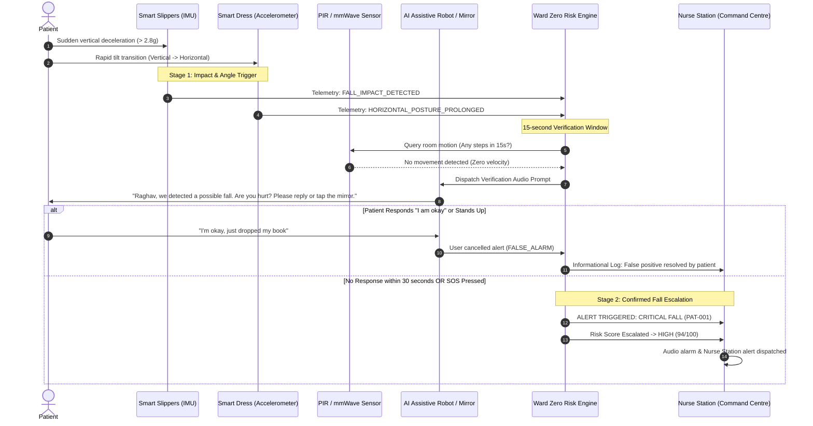

# WARD ZERO — CLINICAL SAFETY, ETHICAL GUARDRAILS, AND SYSTEM LIMITATIONS
## Clinical Decision Support (CDS) Governance, Boundaries, and Risk Mitigation

---

## 1. Regulatory Status and Non-Diagnostic Disclaimer

> [!IMPORTANT]
> **INVESTIGATIONAL PROTOTYPE / CLINICAL DECISION SUPPORT NOTICE**
> 
> **Ward Zero is an assistive remote patient monitoring (RPM), situational awareness, and early triage coordination platform.**
> 
> 1. **Not a Diagnostic Medical Device**: Ward Zero is not approved or cleared by the US Food and Drug Administration (FDA 510(k) / De Novo), the European Medicines Agency (CE Mark MDR Class IIa/IIb), or any international medical regulatory agency. It does not provide medical diagnoses, formal clinical prognoses, or definitive therapeutic prescriptions.
> 2. **Human-in-the-Loop Clinical Authority**: All AI risk scores (LOW, MEDIUM, HIGH), anomaly detections, and trend projections generated by the system are advisory decision-support signals. Final diagnostic judgment, clinical escalation, and treatment orders remain the sole responsibility of licensed healthcare practitioners (Physicians, Registered Nurses, Nurse Practitioners).
> 3. **Non-Autonomous Intervention**: Ward Zero does not actuate closed-loop medical interventions. The system will never independently administer medications, alter infusion pump rates, or override physician orders.

---

## 2. Sensor Demarcation: Continuous Everyday IoT vs. Intermittent Laboratory Inputs

To maintain scientific fidelity and clinical credibility, Ward Zero strictly distinguishes between physiological parameters feasible for passive, non-invasive continuous home monitoring and parameters requiring discrete clinical/laboratory assays:

```
+-----------------------------------------------------------------------------------------+
|                                    WARD ZERO SENSING MODALITIES                         |
+-----------------------------------------------------------------------------------------+
| PASSIVE CONTINUOUS HOME MONITORING                      INTERMITTENT LABORATORY INPUTS  |
| - Heart Rate (Dress ECG, Watch PPG)                    - Blood Glucose (Capillary/Lab)  |
| - Respiratory Rate (Mattress Piezoelectric)            - Serum Creatinine (Venipuncture)|
| - Peripheral SpO2 (Multifunctional Watch)              - Serum Electrolytes (Na+, K+)   |
| - Skin & Ambient Temperature (Dress/PIR)               - Serum Cortisol & Endocrine     |
| - Gait Velocity & Balance (Smart Slippers)             - Full Blood Panel & Urinalysis  |
| - Nocturnal Restlessness (Smart Mattress)              -------------------------------- |
| - Fluid Intake Estimation (Smart Water Bottle)         Presented as timestamped point-  |
| - Pillbox Compartment Access (Smart Pillbox)           in-time assays; NEVER simulated   |
| - Gross Room Occupancy & Motion (PIR/mmWave)           as continuous textile readings.  |
+-----------------------------------------------------------------------------------------+
```

### 2.1 The Smart Pillbox Ingestion Boundary
Opening a smart pillbox compartment registers an event (`COMPARTMENT_OPENED`). **Ward Zero does not assume opening proves ingestion.** A missed compartment access window generates a `MEDICATION_WINDOW_EXPIRED` notification to the caregiver, but the digital twin maintains a distinction between "Physical compartment opened" and "Ingestion clinically confirmed" until confirmed by the caregiver or patient verbal response.

---

## 3. Fall Detection: Two-Stage Verification Protocol

Unverified automated fall detection algorithms can overwhelm emergency medical services (EMS) with false alarms caused by dropping a wearable, sitting down heavily, or erratic movement.

Ward Zero employs a **Two-Stage Multi-Modal Fall Verification Protocol**:



---

## 4. Explainable AI and Clinical Decision-Support Transparency

Black-box machine learning predictions undermine clinical trust and introduce unmitigated medical liability. To counter this, every AI assessment in Ward Zero adheres to strict explainability guidelines:

1. **Deterministic Baseline Delta**: Deviations are expressed relative to the patient's individual 7-day personalized baseline, not arbitrary population averages.
   - *Example*: "Heart rate 104 bpm (+32 bpm above patient resting baseline of 72 bpm)."
2. **Feature Attribution & Multi-Factor Rationale**: The AI engine outputs an itemized breakdown of contributing physiological and behavioral signals:
   - *Primary Driver*: Sustained nocturnal tachypnea (Respiratory rate: 26 breaths/min for 4 hours).
   - *Secondary Driver*: Fluid deficit (Estimated intake 450 mL vs. daily target of 1,800 mL over past 36 hours).
   - *Tertiary Driver*: Missed medication window (Furosemide / Lasix compartment unopened).
3. **Caregiver Semantic Context Integration**: Natural language notes submitted by visiting nurses are analyzed using rule-based semantic NLP to capture subjective signs (e.g., "pedal edema noted", "complains of shortness of breath when lying flat") and factored into the composite score.

---

## 5. Security, Privacy, and Synthetic Data Integrity

Ward Zero is designed according to **Privacy-by-Design** principles consistent with HIPAA (Health Insurance Portability and Accountability Act) and GDPR (General Data Protection Regulation):

- **100% Synthetic Datasets**: All patient names, vital records, clinical histories, and telemetry streams in this hackathon submission are fully synthetic. No real Protected Health Information (PHI) or Personally Identifiable Information (PII) is processed or stored.
- **Role-Based Access Control (RBAC)**: Separation between Caregiver Field Mobile roles, Primary Registered Nurses, and Command Center Escalation Leads.
- **Tamper-Evident Audit Trails**: Every clinical alert acknowledgment, status transition, remote command dispatch, and caregiver clinical observation note is written to an append-only `audit_logs` database table with UTC timestamps, user IDs, IP provenance, and cryptographic session tokens.
- **Zero Third-Party Telemetry Leaks**: The system runs entirely within the designated local host environment without sending patient biometrics to unauthorized external analytics vendors.

---

## 6. System Limitations and Future Roadmap

| Current Limitation | Technical Nature | Clinical Implication | Recommended Mitigation / Future Phase |
| :--- | :--- | :--- | :--- |
| **Indoor Localization Precision** | Room-level proximity via PIR and mmWave grid. | Cannot distinguish between patient sitting in an armchair vs. lying collapsed on an adjacent rug without secondary wearable IMU. | Integrate Ultra-Wideband (UWB) spatial tracking tags into smart slippers or home base stations. |
| **Hydration Volume Estimation** | Weight-based delta from smart water bottle. | Spillages or filling an external glass may overestimate patient intake. | Add capacitive fluid sensor and visual confirmation prompt at the digital mirror. |
| **Skin Temperature Artifacts** | Surface infrared thermistor embedded in textile fabric. | Influenced by heavy blankets, drafts, or room ambient temperature shifts. | Implement dual-thermistor differential sensing (core-ambient gradient estimation). |
| **Speech Recognition in High Noise** | Assistive robot natural language parser. | Ambient television or blender noise could interfere with fall verification. | Fall verification audio prompt accompanied by high-contrast flashing visual cue on Smart Mirror and tablet. |

